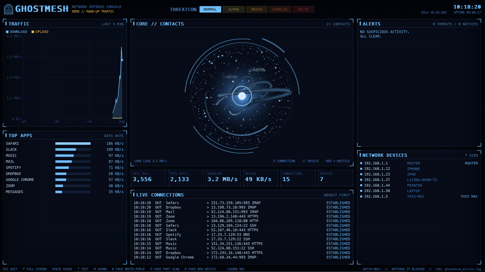

# GhostMesh – Network Defense Console

A full-screen, real-time network monitoring console for macOS, written in Python with pygame. GhostMesh watches the Mac's own network activity and shows it on a tactical "SOC-style" display with a 3D holographic core, live traffic graphs, device tracking and threat alerts.

> **Watch-only.** GhostMesh never reads the contents of your traffic and never blocks or changes anything. No admin password is needed. It is an educational project, not a replacement for real security software.

## Features

| Panel | What it shows |
|-------|---------------|
| **Core // Contacts** | Every connection and every device on the network as a point on a spinning 3D particle sphere |
| **THREATCON** | Overall threat level: NORMAL / ALPHA / BRAVO / CHARLIE / DELTA |
| **Traffic** | Live download and upload speed for the last 3 minutes |
| **Top Apps** | Which apps on the Mac are using the internet right now |
| **Network Devices** | Other devices on the local network, with an alert when a new one joins |
| **Alerts** | Suspicious patterns, with a sound, a macOS notification and a saved log file |
| **Live Connections** | A scrolling feed of new inbound and outbound connections |

## Detection rules

| Alert | Trigger |
|-------|---------|
| Possible port scan | One address touches 4+ of your ports within 10 seconds |
| Repeated login attempts | One address connects 5+ times to the same port within 10 seconds (possible brute force) |
| Port probing from this Mac | This Mac contacts 6+ ports on one address within 10 seconds |
| Suspicious port | Outbound connection to ports linked to hacking tools, IRC botnets or Tor (e.g. 4444, 6667, 9050) |
| New listening port | A program on this Mac starts accepting connections |
| New device on network | A new hardware (MAC) address appears in the ARP table |
| Router identity changed | The router's hardware address changes (possible ARP spoofing) |
| Connection burst / unanswered connections | Unusually many new or unanswered connections |

## How it works

GhostMesh reads built-in macOS command-line tools in background threads, so the display never freezes:

- `netstat` for open connections and packet/byte counters
- `lsof` to match connections to app names
- `nettop` for per-app data rates
- `arp` and `route` for devices on the local network and the router

## Requirements

- macOS (live mode). Demo mode also runs on other systems.
- Python 3
- pygame-ce

```bash
python3 -m pip install pygame-ce
```

## Usage

```bash
python3 ghostmesh.py          # LIVE: watch this Mac's real network
python3 ghostmesh.py --demo   # DEMO: practice mode with made-up traffic
```

### Keys

| Key | Action |
|-----|--------|
| ESC | Quit |
| F | Full screen on/off |
| SPACE | Pause |
| T | Test alert |
| M | Sound on/off |
| B | Fake brute-force attack *(demo only)* |
| P | Fake port scan *(demo only)* |
| N | Fake new device *(demo only)* |

Alerts are saved to `ghostmesh_alerts.log` next to the program. That file stays on your computer and is excluded from this repository, because it contains real addresses from your network.

## Screenshots

<!-- Add a screenshot of the console to a "screenshots" folder as console.png -->


## Related project

- [SOC Home Lab](https://github.com/mrghostadmin/soc-home-lab): a Wazuh SIEM lab running on the same MacBook Air
